# SOPilot

**Every step, cited**

<kbd>Python</kbd> <kbd>FastAPI</kbd> <kbd>React</kbd> <kbd>Vite</kbd> <kbd>OpenAI API</kbd>

SOPilot is a retrieval-augmented assistant for security operations. It turns a raw security alert into a verified containment checklist whose steps cite exact passages from approved playbooks, then produces an incident ticket for analyst review and approval. When the available evidence does not support an approved procedure, it returns an explicit fallback and escalation guidance.

**Demo video:** [link](https://drive.google.com/file/d/1GCINA5mhnCNQp0dYepw1n0Pp__-JNTDE/view?usp=sharing)

## Table of contents

- [The problem](#the-problem)
- [The solution](#the-solution)
- [Screenshots](#screenshots)
- [How it works](#how-it-works)
- [Architecture](#architecture)
- [How OpenAI is used](#how-openai-is-used)
- [Responsible AI](#responsible-ai)
- [Evaluation](#evaluation)
- [Repository structure](#repository-structure)
- [Getting started](#getting-started)
- [API reference](#api-reference)
- [Data](#data)
- [Testing](#testing)
- [Project docs and contract](#project-docs-and-contract)
- [Limitations and future work](#limitations-and-future-work)
- [Hackathon context](#hackathon-context)
- [Security notes](#security-notes)
- [Team, license and acknowledgements](#team-license-and-acknowledgements)

## The problem

During a live alert, analysts must move between event details, response runbooks and vulnerability information. Finding a plausible action is only part of the job: the analyst also needs to establish where it came from, whether it applies, and what can safely go into the incident record. That search and documentation work competes with time needed to investigate.

## The solution

SOPilot brings the alert, supporting procedure and incident record into one review flow. It proposes guidance; the analyst reviews and approves the ticket.

| Feature | What it does |
|---|---|
| Alert parsing | Extracts IoCs and classifies attack type and severity from raw JSON. |
| Playbook and CVE retrieval | Searches a local knowledge base using semantic similarity and BM25; looks up CVE records through a function tool. |
| Grounded checklist | Returns ordered actions, rationales and citations containing playbook ID, step ID and exact source text. |
| Verification | Checks citations deterministically, then judges support with a separate model pass; drops unsupported steps and flags partial support. |
| Explicit fallbacks | Returns `no_matching_sop` when classification or retrieval is insufficient, and `low_confidence` when too few verified steps remain. |
| Analyst approval | Requires an analyst name and makes approved tickets read-only in the application. |
| Incident ticket | Includes a timeline, a root-cause **Hypothesis**, IoCs, cited actions, assets and CVEs; supports Markdown export. |
| Audit trail | Records pipeline stages, models, timestamps, hashes and structured details for each run. |

## Screenshots


| Intake and evidence | Checklist and review |
|---|---|
| 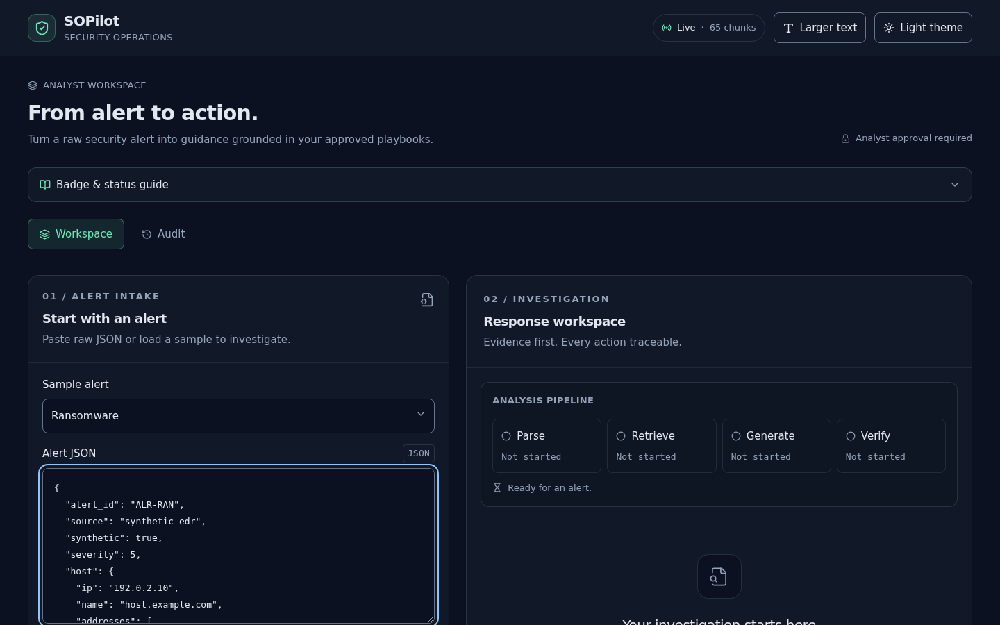<br>**Intake:** load the ransomware sample or paste alert JSON. | 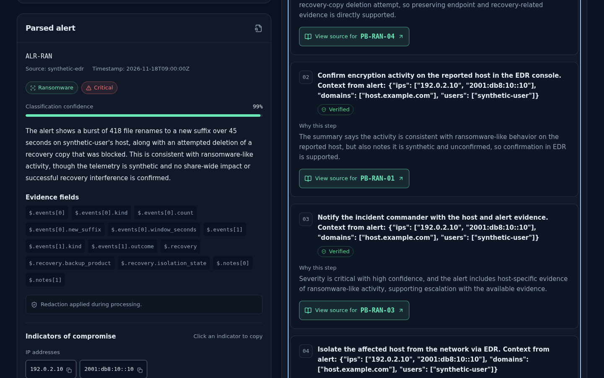<br>**Parsed alert:** review classification, evidence and IoCs. |
| 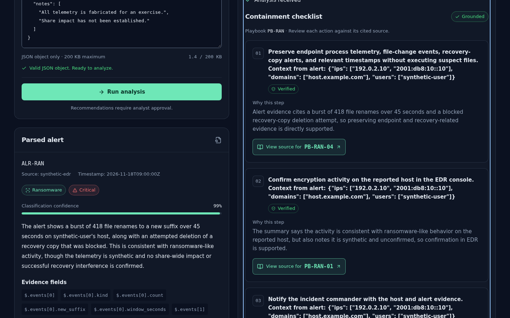<br>**Grounded checklist:** actions carry prominent source citations. | 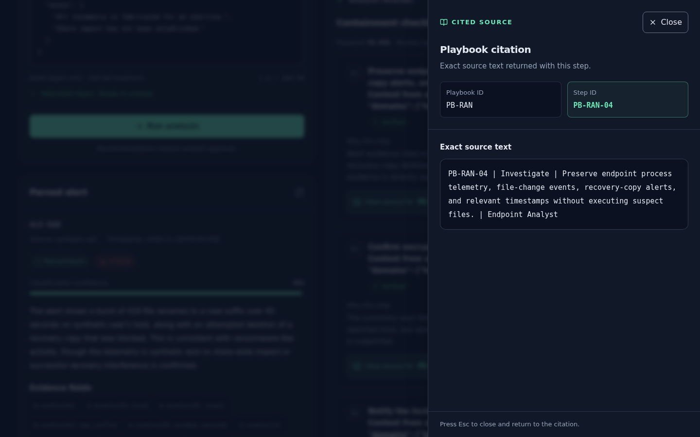<br>**Citation panel:** inspect the exact playbook step text. |
| 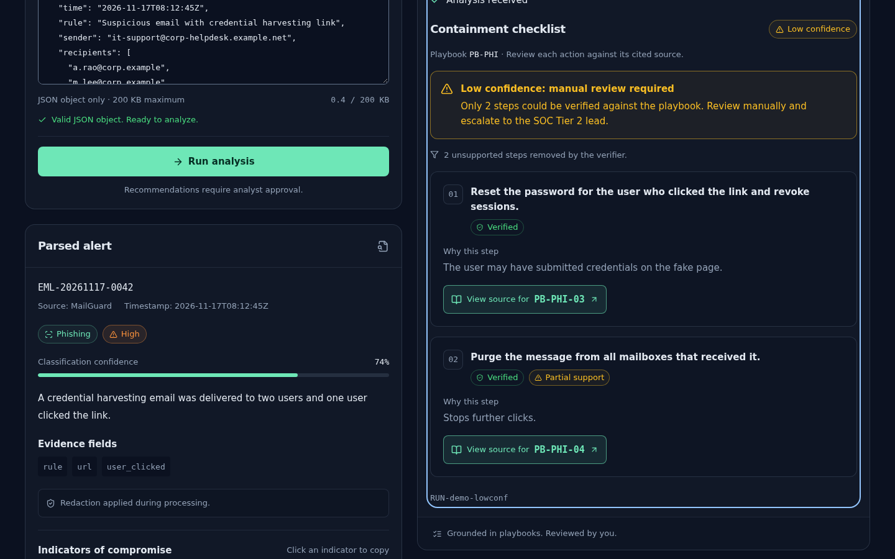<br>**Low confidence - Mock:** retained steps remain available for manual review. | 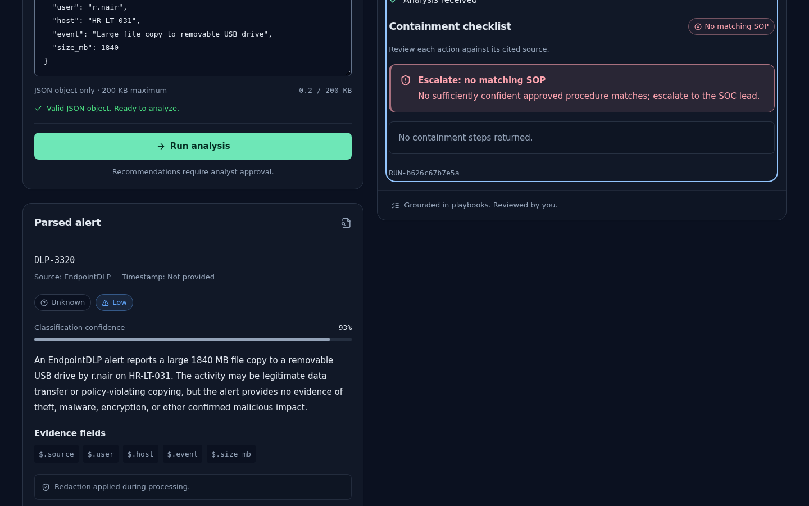<br>**No match - Live USB input:** escalate without improvised containment steps. |
| 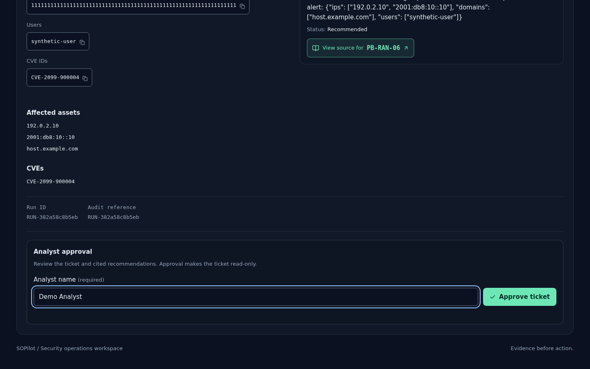<br>**Approval:** review the draft and enter an analyst name. | 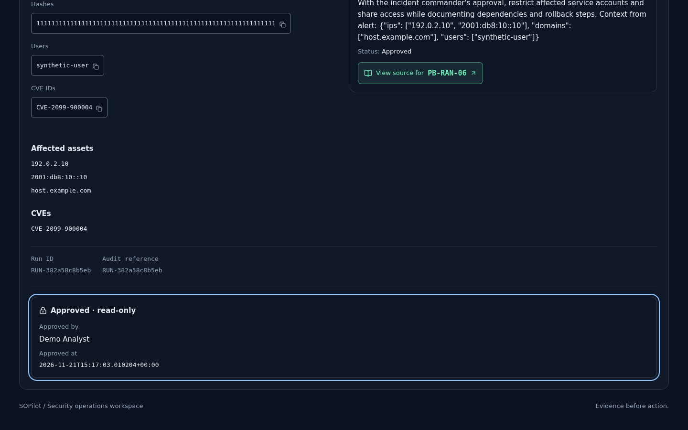<br>**Approved ticket:** read-only approval details are visible. |
| 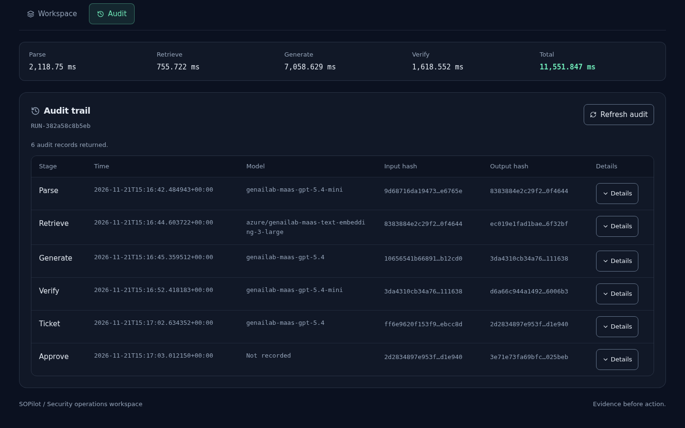<br>**Audit:** inspect one row for each recorded stage. | Captures show synthetic data. Recorded evaluation results and their limitations appear below. |

## How it works

The pipeline has a fixed orchestration order. Draft-ticket generation precedes the analyst's approval; audit records are written throughout the flow.

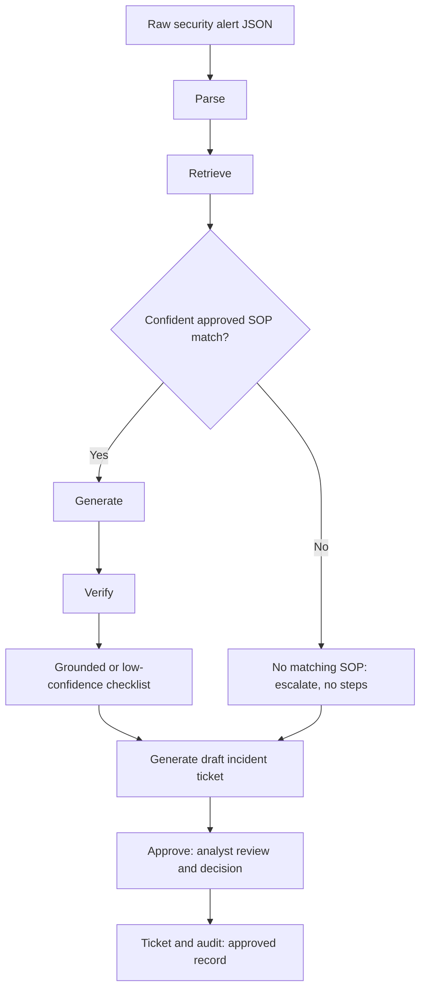

| Stage | What happens | Model role |
|---|---|---|
| Parse | Extract indicators, mask identities before classification, and validate the parsed alert. | `MODEL_FAST` |
| Retrieve | Embed the query and rank playbook steps with hybrid semantic and keyword scores. | `MODEL_EMBED` |
| Generate | Produce actions constrained to retrieved steps; request CVE lookup when relevant. | `MODEL_MAIN` |
| Verify | Validate citations, assess support, drop unsupported steps, and apply the verified-step minimum. | `MODEL_FAST` plus deterministic checks |
| Approve | An analyst reviews the draft and supplies a non-empty name. | Human decision |
| Ticket and audit | Generate the draft before approval, retain the approved record, and record each stage. | Main-model ticket generation; deterministic persistence and approval |

A single run request crosses the frontend, backend, vector store and configured model gateway:

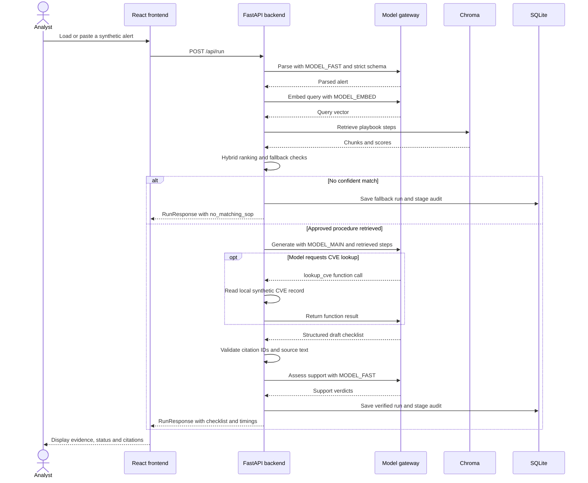

## Architecture

| Component | Responsibility |
|---|---|
| React, Vite and strict TypeScript | Intake, parsed alert, checklist, citation panel, approval and audit views. |
| TanStack Query | Frontend query and mutation state. |
| FastAPI and Pydantic | HTTP boundary, schema validation, orchestration and persistence. |
| Chroma | Persistent playbook-step and CVE vectors in `data/chroma`; collection `soc_chunks`. |
| SQLite | Runs, tickets and stage audit in `data/app.db`. |
| Model gateway | Responses and embedding calls routed through [the LLM adapter](backend/app/llm.py). |

Model identifiers below are the routing names in [.env.example](.env.example), not a claim that every provider accepts these aliases.

| Role | Environment variable | Example routing name |
|---|---|---|
| Checklist and ticket generation | `MODEL_MAIN` | `genailab-maas-gpt-5.4` |
| Classification and support verification | `MODEL_FAST` | `genailab-maas-gpt-5.4-mini` |
| Model-call fallback | `MODEL_FALLBACK` | `azure/genailab-maas-gpt-4.1` |
| Knowledge-base and query embeddings | `MODEL_EMBED` | `azure/genailab-maas-text-embedding-3-large` |

The design uses deterministic orchestration around model calls: schemas define the boundary, citations restrict the allowed evidence, a verifier checks the draft, explicit fallbacks prevent unsupported guidance, and a person controls approval. A fixed pipeline does not make model outputs deterministic.

## How OpenAI is used

| Capability | Application | Implementation |
|---|---|---|
| Responses API | Classification, checklist generation, support assessment and ticket generation. | [llm.py](backend/app/llm.py) |
| Strict structured outputs | Model responses must satisfy Pydantic-derived schemas and validate again after generation. | [llm.py](backend/app/llm.py), [schemas.py](backend/app/schemas.py) |
| Function calling | `lookup_cve` returns a local CVE record or an explicit not-found result. | [cve.py](backend/app/cve.py), [generate.py](backend/app/generate.py) |
| Embeddings | Index synthetic knowledge-base chunks and embed retrieval queries. | [ingest.py](backend/app/ingest.py), [retrieval.py](backend/app/retrieval.py) |
| Second-model verification | The fast-model pass judges support after main-model generation. | [verify.py](backend/app/verify.py) |

Codex was used to build and verify the system under the rules in [AGENTS.md](AGENTS.md): work from the shared spec, keep model prompts in a dedicated module, limit backend changes to reproduced fixes, and use tests as acceptance checks.


## Responsible AI

| Control | Behavior and boundary | Enforcement location |
|---|---|---|
| Citation or silence | Steps must cite allowed playbook IDs and exact source text; absence of evidence is an explicit outcome. | [generate.py](backend/app/generate.py), [verify.py](backend/app/verify.py) |
| Retrieval fallback | Unknown attack type or insufficient score/margin returns `no_matching_sop` with no steps. | [generate.py](backend/app/generate.py), [contract](docs/spec.md) |
| Verifier pass | Unsupported steps are removed; partial support is flagged; too few retained steps produces `low_confidence`. | [verify.py](backend/app/verify.py) |
| Human approval | A name is required; approved tickets become read-only in the application. | [audit.py](backend/app/audit.py), [contract](docs/spec.md) |
| Prompt-injection handling | Alert text is treated as untrusted data; model-facing prompts instruct against following embedded instructions. | [prompts.py](backend/app/prompts.py), [parser.py](backend/app/parser.py) |
| Identity masking and redaction | Emails and usernames are masked before classification and restored afterward; IP redaction is configurable. This is not a guarantee of anonymized storage. | [parser.py](backend/app/parser.py), [contract](docs/spec.md) |
| Synthetic data only | The seed corpus uses fictional events and reserved/example indicators. | [data](#data), [AGENTS.md](AGENTS.md) |
| Audit trail | Stage records contain timestamps, models, hashes and structured details. | [audit.py](backend/app/audit.py) |
| Hypothesis labelling | Root cause remains a labelled hypothesis with confidence and a stated basis. | [ticket.py](backend/app/ticket.py), [ticket contract](docs/spec.md) |

SOPilot provides reviewable guidance. Citation validity and a support verdict do not establish that a proposed action is correct for a real environment.

## Evaluation

The recorded evaluation uses **12 synthetic cases**: **5 clean, 2 reworded, 1 ambiguous, 2 no-match, 1 injection and 1 missing-fields**. Parse, retrieve and generate run once per case; the without-verifier and with-verifier branches share the same draft. The recorded cutoffs are `RETRIEVAL_MIN_SCORE=0.29` and `RETRIEVAL_MIN_MARGIN=0.03`.

| Metric | Without verifier | With verifier |
|---|---:|---:|
| Playbook match accuracy | 83.33% | 83.33% |
| Citation validity | 100.00% | 100.00% |
| Unsupported-step rate | 0.00% | 0.00% |
| Correct fallback rate | 100.00% | 100.00% |
| p50 latency (ms) | 5234.30 | 6069.40 |
| p95 latency (ms) | 11230.54 | 12933.22 |
| Returned steps | 32 | 32 |
| Completed cases | 12 | 12 |
| Failed cases | 0 | 0 |

The citation-validity rate checks indexed IDs, playbook membership, exact source text and retrieved-input membership; it does not mean every expected outcome passed. Unsupported-step labels come from the production verifier rather than independent human review, and correct fallback is measured only on cases that expect a fallback.

<details>
<summary>Category results and expected-outcome misses</summary>

| Category | Without verifier | With verifier |
|---|---:|---:|
| clean | 5/5 | 5/5 |
| reworded | 0/2 | 0/2 |
| ambiguous | 1/1 | 1/1 |
| no_match | 2/2 | 2/2 |
| injection | 1/1 | 1/1 |
| missing_fields | 1/1 | 1/1 |

| Case | Returned status | Playbook | Expected playbook | Reason |
|---|---|---|---|---|
| E06 `CASE-reworded-phishing` | no_matching_sop | null | PB-PHI | score 0.262414 < 0.29; margin 0.000000 < 0.03 |
| E07 `CASE-reworded-ransomware` | no_matching_sop | null | PB-RAN | score 0.137328 < 0.29; margin 0.022331 < 0.03 |

These false fallbacks are quality misses, not execution or citation-gate failures. Raw positive drafts remain `low_confidence` pending verification; the verified branch returns the final support-based status. The full method and snapshot are in [eval/report.md](eval/report.md).

</details>

## Repository structure

```text
.
├── AGENTS.md                 # Development and integration rules
├── github_readme.md          # This GitHub-facing overview
├── FREEZE.md                 # Recorded verification and exact demo commands
├── pyproject.toml            # Backend dependencies and pytest configuration
├── .env.example              # Backend configuration template
├── backend/
│   ├── app/                  # API, pipeline, model adapter and persistence
│   └── tests/                # Backend regression and gateway tests
├── frontend/
│   ├── package.json          # Frontend dependencies and npm commands
│   ├── package-lock.json     # Frontend dependency lockfile
│   ├── src/                  # React UI, API clients, hooks and fixtures
│   ├── e2e/                  # Live Playwright checks
│   ├── scripts/              # Screenshot and demo verification tools
│   └── public/               # Static frontend assets
├── data/
│   ├── playbooks/            # Approved synthetic response procedures
│   ├── cves/                 # Fictional vulnerability feed
│   ├── alerts/               # Sample raw alerts
│   ├── eval/                 # Evaluation cases
│   └── mock/                 # Canned backend responses
├── eval/                     # Evaluator, current report and timestamped runs
├── golden/                   # Archived contract response examples
├── scripts/                  # Ingestion support, smoke, export and reset tools
└── docs/                     # Contract, schemas, screenshots and fix notes
```

Generated dependencies, caches, build output and runtime databases are omitted from this tree.

## Getting started

### Prerequisites

- Python **3.11** for the verified setup; the backend manifest requires Python **3.11 or newer**.
- Node **20.19+ within the 20.x line, or 22.12+**, with npm, as specified by the frontend manifest.
- A configured model gateway for live mode, including compatible Responses, structured-output, function-call and embedding support.
- A local copy of this folder. Run backend commands from the root containing `pyproject.toml`.

**Verification scope:** clean backend and frontend installs, ingestion, build, tests and live startup were exercised on Linux in isolated environments. The macOS shell and Windows PowerShell equivalents below have not been executed on those platforms.

### Backend setup

Create your own root `.env` using [.env.example](.env.example) as a guide. Supply credentials locally and set `LLM_BASE_URL` to your gateway, for example `https://<your-gateway>/`. Model-routing aliases must match that gateway. Existing environment files are never overwritten by these commands.

<details open>
<summary>Linux / macOS shell</summary>

```bash
python3.11 -m venv .venv
.venv/bin/python -m pip install -e ".[dev,vectors]"
```

Build the index before starting the live backend:

```bash
MOCK=0 ANONYMIZED_TELEMETRY=false .venv/bin/python -m backend.app.ingest --rebuild
```

Start the API, keeping this terminal open. These thresholds reproduce the recorded evaluation configuration rather than the initial score default:

```bash
export MOCK=0
export RETRIEVAL_MIN_SCORE=0.29
export RETRIEVAL_MIN_MARGIN=0.03
export ANONYMIZED_TELEMETRY=false
.venv/bin/python -m uvicorn backend.app.main:app --host 127.0.0.1 --port 8000 --no-access-log --log-level warning
```

</details>

<details>
<summary>Windows PowerShell - platform equivalent, not natively tested</summary>

```powershell
py -3.11 -m venv .venv
.\.venv\Scripts\python.exe -m pip install -e ".[dev,vectors]"
$env:MOCK = "0"
$env:ANONYMIZED_TELEMETRY = "false"
.\.venv\Scripts\python.exe -m backend.app.ingest --rebuild
$env:RETRIEVAL_MIN_SCORE = "0.29"
$env:RETRIEVAL_MIN_MARGIN = "0.03"
.\.venv\Scripts\python.exe -m uvicorn backend.app.main:app --host 127.0.0.1 --port 8000 --no-access-log --log-level warning
```

</details>

The verified corpus indexes **65 chunks: 50 playbook steps and 15 CVEs**. Health at `/api/health` should report `status: "ok"`, `mock: false` and a positive `index_chunks` value. Rebuild the index if the configured embedding model changes.

### Frontend setup and UI

Open another terminal in `frontend/`.

<details open>
<summary>Linux / macOS shell</summary>

```bash
npm ci
export VITE_USE_MOCK=false
export VITE_API_BASE_URL=http://localhost:8000/api
npm run dev -- --host localhost --port 5173 --strictPort
```

</details>

<details>
<summary>Windows PowerShell - platform equivalent, not natively tested</summary>

```powershell
npm ci
$env:VITE_USE_MOCK = "false"
$env:VITE_API_BASE_URL = "http://localhost:8000/api"
npm run dev -- --host localhost --port 5173 --strictPort
```

</details>

Open `http://localhost:5173`. The header should say **Live** and show the index chunk count. The development CORS origin is `http://localhost:5173`.

This workspace also provides a local Node/npm tool directory. If npm is not on PATH here, run `export PATH="$PWD/.tools/bin:$PATH"` from `frontend/` on Linux before the npm commands.

### Mock mode versus live mode

| Mode | Settings | Behavior |
|---|---|---|
| Live full stack | Backend `MOCK=0`; frontend `VITE_USE_MOCK=false` | The UI calls the configured API and the backend uses the configured gateway and index. |
| Backend fixtures over HTTP | Backend `MOCK=1`; frontend `VITE_USE_MOCK=false` | The backend serves canned responses; it does not measure live model quality. |
| Frontend fixtures | Frontend `VITE_USE_MOCK=true` | The UI uses its local mock client without requiring a backend. |

To change backend mode, stop the API and restart its command with `MOCK=1` or `MOCK=0` (`$env:MOCK` in PowerShell). To change frontend mode, set `VITE_USE_MOCK` and restart Vite. Use live mode for the end-to-end test and evaluation.

### Reset the demo

Stop the backend first, then run from the root:

```bash
.venv/bin/python scripts/reset_demo.py
```

PowerShell equivalent:

```powershell
.\.venv\Scripts\python.exe scripts/reset_demo.py
```

The reset prints deleted and remaining counts for `runs`, `tickets` and `audit`. It preserves the vector index and restores the database's deletion guards. Restart the backend and reload the UI afterward.

<details>
<summary>Environment variables and defaults</summary>

Backend defaults below come from [.env.example](.env.example). Process environment variables override the local configuration file.

| Variable | Purpose | Default / configuration |
|---|---|---|
| `LLM_KEY` | Gateway credential; keep only in local backend configuration | Unset |
| `LLM_BASE_URL` | Model gateway address | Configure locally, e.g. `https://<your-gateway>/` |
| `TLS_VERIFY` | Verify the gateway TLS certificate | `false`; see [security notes](#security-notes) |
| `MODEL_MAIN` | Generation model | `genailab-maas-gpt-5.4` |
| `MODEL_FAST` | Classification and verification model | `genailab-maas-gpt-5.4-mini` |
| `MODEL_FALLBACK` | Model-call fallback | `azure/genailab-maas-gpt-4.1` |
| `MODEL_EMBED` | Embedding model | `azure/genailab-maas-text-embedding-3-large` |
| `EMBED_BATCH_SIZE` | Ingestion embedding batch size | `32` |
| `MOCK` | Backend canned-response mode | `0` |
| `RETRIEVAL_TOP_K` | Retrieved step limit | `6` |
| `RETRIEVAL_MIN_SCORE` | Absolute retrieval cutoff | `0.35` initially; evaluation used `0.29` |
| `RETRIEVAL_MIN_MARGIN` | Cross-playbook margin cutoff | `0.03` |
| `HYBRID_WEIGHT_SEMANTIC` | Semantic share of hybrid score | `0.7` |
| `BM25_K1` / `BM25_B` | Keyword-scoring parameters | `1.5` / `0.75` |
| `BM25_SCORE_SCALE` | Absolute keyword-score normalization | `8.0` |
| `SEMANTIC_SIMILARITY_FLOOR` | Semantic baseline normalization | `0.3` |
| `PARSE_MIN_CONFIDENCE` | Below this, classify as unknown | `0.5` |
| `PARSE_CACHE_SIZE` | Validated classification cache capacity | `128` |
| `MIN_VERIFIED_STEPS` | Minimum retained steps for grounded status | `3` |
| `REDACT_IPS` | Optional IP redaction | `false` |
| `MAX_REQUEST_BYTES` | Maximum request-body size | `204800` bytes |
| `DATA_DIR` | Runtime-storage override | Repository `data/` when unset |
| `VITE_API_BASE_URL` | Public frontend API base | Set explicitly to your backend API base |
| `VITE_USE_MOCK` | Frontend mock-client selection | Set explicitly: `false` live, `true` fixtures |

</details>

## API reference

The API base path is `/api`. JSON POST bodies require an appropriate JSON content type. Errors use the documented `error` envelope with sanitized messages.

| Method | Endpoint | Request | Response |
|---|---|---|---|
| GET | `/health` | None | Status, mode and index chunk count |
| GET | `/samples` | None | Sample IDs, names and alert objects |
| POST | `/alerts/parse` | `{ "alert": object }` | Parsed alert |
| POST | `/run` | `{ "alert": object }` | Run ID, parsed alert, checklist and timings |
| POST | `/checklist` | `{ "parsed": ParsedAlert }` | Retrieved and verified checklist |
| POST | `/ticket` | `{ "run_id": string }` | Draft incident ticket |
| POST | `/approve` | `{ "ticket_id": string, "analyst_name": string }` | Approved ticket; conflict if already approved |
| GET | `/tickets/{ticket_id}/export.md` | Ticket ID in path | Markdown export |
| GET | `/search?q=&k=` | Query and result limit | Scored playbook hits |
| GET | `/audit?run_id=` | Run ID | Stage audit rows |

<details>
<summary>POST /api/run - real sample request and archived golden response</summary>

This request is the ransomware alert returned by `/api/samples` during setup verification. The response is copied from [golden/run-ransomware.json](golden/run-ransomware.json), captured for the same alert ID; a new live run can produce different IDs, wording, steps and timings.

Request, with `Content-Type: application/json`:

```json
{
  "alert": {
    "alert_id": "ALR-RAN",
    "source": "synthetic-edr",
    "synthetic": true,
    "severity": 5,
    "host": {
      "ip": "192.0.2.10",
      "name": "host.example.com",
      "addresses": [
        "192.0.2.10",
        "2001:db8:10::10"
      ],
      "assetTag": "LAB-ENDPOINT-010"
    },
    "events": [
      {
        "TimeCreated": "2026-11-18T08:58:42Z",
        "kind": "file_rename_burst",
        "count": "418",
        "new_suffix": ".lablocked",
        "window_seconds": 45
      },
      {
        "TimeCreated": "2026-11-18T08:59:04+00:00",
        "kind": "recovery_copy_delete_attempt",
        "outcome": "blocked",
        "process_ref": "proc-synthetic-771"
      },
      "Mass file renames on the lab host; recovery-copy deletion was attempted."
    ],
    "process": {
      "image": "C:\\Lab\\synthetic-file-worker.exe",
      "pid": 771,
      "parent": {
        "image": "C:\\Lab\\exercise-runner.exe",
        "pid": "640"
      },
      "user": "synthetic-user",
      "sha256": "1111111111111111111111111111111111111111111111111111111111111111",
      "fingerprint_note": "Synthetic placeholder digest, not an observed malware hash."
    },
    "recovery": {
      "last_known_good": "2026-11-17T23:00:00Z",
      "backup_product": "Training Backup Coordinator 3.0",
      "finding_refs": [
        "CVE-2099-900004"
      ],
      "isolation_state": "pending_analyst_review"
    },
    "timestamp": "2026-11-18T09:00:00Z",
    "notes": [
      "All telemetry is fabricated for an exercise.",
      "Share impact has not been established."
    ]
  }
}
```

Archived response:

```json
{
  "run_id": "RUN-da61fedbf22a",
  "parsed": {
    "alert_id": "ALR-RAN",
    "source": "synthetic-edr",
    "timestamp": "2026-11-18T09:00:00Z",
    "attack_type": "ransomware",
    "severity": "critical",
    "confidence": 0.98,
    "summary": "The alert shows a burst of 418 file renames to a new '.lablocked' suffix within 45 seconds on the host, which is consistent with mass encryption or file locking behavior. A recovery-copy deletion was also attempted, although it was blocked, so the impact is not fully confirmed beyond strong ransomware-like activity.",
    "iocs": {
      "ips": [
        "192.0.2.10",
        "2001:db8:10::10"
      ],
      "domains": [
        "host.example.com"
      ],
      "urls": [],
      "hashes": [
        "1111111111111111111111111111111111111111111111111111111111111111"
      ],
      "emails": [],
      "users": [
        "synthetic-user"
      ],
      "cve_ids": [
        "CVE-2099-900004"
      ],
      "resources": []
    },
    "evidence_fields": [
      "$.events[0]",
      "$.events[0].kind",
      "$.events[0].count",
      "$.events[0].new_suffix",
      "$.events[0].window_seconds",
      "$.events[1]",
      "$.events[1].kind",
      "$.events[1].outcome",
      "$.recovery",
      "$.recovery.isolation_state"
    ],
    "redacted": true
  },
  "checklist": {
    "alert_id": "ALR-RAN",
    "status": "grounded",
    "playbook_id": "PB-RAN",
    "retrieval_confidence": 0.35103838550276767,
    "steps": [
      {
        "order": 1,
        "action": "Confirm encryption activity on the reported host in the EDR console. Context from alert: {\"ips\": [\"192.0.2.10\", \"2001:db8:10::10\"], \"domains\": [\"host.example.com\"], \"users\": [\"synthetic-user\"]}",
        "rationale": "Alert evidence shows 418 file renames to a new '.lablocked' suffix within 45 seconds, which strongly supports suspected encryption activity on the reported host.",
        "citation": {
          "playbook_id": "PB-RAN",
          "step_id": "PB-RAN-01",
          "source_text": "PB-RAN-01 | Detect | Confirm encryption activity on the reported host in the EDR console. | SOC Tier 2"
        },
        "verified": true,
        "support": "supported"
      },
      {
        "order": 2,
        "action": "Preserve endpoint process telemetry, file-change events, recovery-copy alerts, and relevant timestamps without executing suspect files. Context from alert: {\"ips\": [\"192.0.2.10\", \"2001:db8:10::10\"], \"domains\": [\"host.example.com\"], \"users\": [\"synthetic-user\"]}",
        "rationale": "The alert explicitly references file-change behavior, a blocked recovery-copy deletion attempt, and specific evidence fields and timestamps that should be preserved.",
        "citation": {
          "playbook_id": "PB-RAN",
          "step_id": "PB-RAN-04",
          "source_text": "PB-RAN-04 | Investigate | Preserve endpoint process telemetry, file-change events, recovery-copy alerts, and relevant timestamps without executing suspect files. | Endpoint Analyst"
        },
        "verified": true,
        "support": "supported"
      },
      {
        "order": 3,
        "action": "Isolate the affected host from the network via EDR. Context from alert: {\"ips\": [\"192.0.2.10\", \"2001:db8:10::10\"], \"domains\": [\"host.example.com\"], \"users\": [\"synthetic-user\"]}",
        "rationale": "Severity is critical with high confidence, and the observed burst of rename activity is consistent with active ransomware-like behavior, supporting immediate containment of the affected host.",
        "citation": {
          "playbook_id": "PB-RAN",
          "step_id": "PB-RAN-02",
          "source_text": "PB-RAN-02 | Contain | Isolate the affected host from the network via EDR. | SOC Tier 2"
        },
        "verified": true,
        "support": "supported"
      },
      {
        "order": 4,
        "action": "Notify the incident commander with the host and alert evidence. Context from alert: {\"ips\": [\"192.0.2.10\", \"2001:db8:10::10\"], \"domains\": [\"host.example.com\"], \"users\": [\"synthetic-user\"]}",
        "rationale": "The alert indicates strong ransomware-like activity on the host and includes concrete host and evidence details appropriate for escalation.",
        "citation": {
          "playbook_id": "PB-RAN",
          "step_id": "PB-RAN-03",
          "source_text": "PB-RAN-03 | Escalate | Notify the incident commander with the host and alert evidence. | SOC Tier 2"
        },
        "verified": true,
        "support": "supported"
      },
      {
        "order": 5,
        "action": "Identify affected shares and peer hosts from existing endpoint and file-access logs to establish the incident scope. Context from alert: {\"ips\": [\"192.0.2.10\", \"2001:db8:10::10\"], \"domains\": [\"host.example.com\"], \"users\": [\"synthetic-user\"]}",
        "rationale": "Mass file renames on the host create a credible need to determine whether shares or peer hosts were also affected using existing logs.",
        "citation": {
          "playbook_id": "PB-RAN",
          "step_id": "PB-RAN-05",
          "source_text": "PB-RAN-05 | Investigate | Identify affected shares and peer hosts from existing endpoint and file-access logs to establish the incident scope. | SOC Tier 2"
        },
        "verified": true,
        "support": "supported"
      },
      {
        "order": 6,
        "action": "Reconnect recovered systems only after endpoint checks pass and monitor for renewed encryption or unauthorized access. Context from alert: {\"ips\": [\"192.0.2.10\", \"2001:db8:10::10\"], \"domains\": [\"host.example.com\"], \"users\": [\"synthetic-user\"]}",
        "rationale": "The alert describes ransomware-like activity and attempted recovery-copy interference, so any later reconnection should wait for successful checks and continued monitoring.",
        "citation": {
          "playbook_id": "PB-RAN",
          "step_id": "PB-RAN-10",
          "source_text": "PB-RAN-10 | Recover | Reconnect recovered systems only after endpoint checks pass and monitor for renewed encryption or unauthorized access. | Incident Commander"
        },
        "verified": true,
        "support": "supported"
      }
    ],
    "related_cves": [
      {
        "id": "CVE-2099-900004",
        "severity": "critical",
        "cvss": 9.1,
        "remediation": "Apply the lab role-boundary fix, protect known-good recovery points, and test restore integrity before reconnecting recovered systems."
      }
    ],
    "escalation_note": "",
    "dropped_count": 0
  },
  "timings_ms": {
    "parse": 1801.4047599999685,
    "retrieve": 295.15315399999054,
    "generate": 8903.617242999986,
    "verify": 2247.5655079999797,
    "total": 13247.9522509999
  }
}
```

</details>

## Data

The seed corpus is fictional: **5 playbooks**, a local synthetic CVE feed with **15 records**, and **6 sample alerts**. Playbooks cover phishing (`PB-PHI`), ransomware (`PB-RAN`), credential stuffing (`PB-CRD`), DDoS (`PB-DOS`) and public S3 buckets (`PB-S3`). The alerts include ambiguous and unknown/no-match cases.

Each playbook step becomes a chunk. The approved format is:

```text
PB-RAN-01 | Detect | Confirm encryption activity on the reported host in the EDR console. | SOC Tier 1
```

The full format, allowed phases and metadata are specified in [the contract](docs/spec.md). CVE records are also indexed and can be returned through `lookup_cve`. Indicator addresses and domains are examples; the CVE feed is not a live threat-intelligence service.

## Testing

The recorded freeze passed **253 backend tests** with **1 packaging test deselected**, **390 frontend tests across 28 files**, the production build and **2 live end-to-end tests**. The backend count includes the opt-in real gateway smoke test; see [FREEZE.md](FREEZE.md) for its scope and the environment-file restriction behind the exclusion.

From the root, Linux/macOS:

```bash
SOPILOT_LIVE_GATEWAY=1 .venv/bin/python -m pytest -q -k 'not test_package_version_allowlist_and_no_secrets'
```

PowerShell equivalent:

```powershell
$env:SOPILOT_LIVE_GATEWAY = "1"
.\.venv\Scripts\python.exe -m pytest -q -k "not test_package_version_allowlist_and_no_secrets"
```

From `frontend/`, on either platform:

```bash
npm test
npm run build
npx playwright install chromium
npm run e2e
```

End-to-end tests require the live backend and its populated index. Keep the frontend API base configured as above; Playwright can start the local frontend if needed. `E2E_BASE_URL` can instead point at an existing frontend, as used during freeze verification.

<details>
<summary>Run a new evaluation without overwriting the frozen evidence</summary>

Linux/macOS, from the root:

```bash
run_dir="eval/runs/$(date -u +%Y%m%dT%H%M%SZ)"
MOCK=0 RETRIEVAL_MIN_SCORE=0.29 RETRIEVAL_MIN_MARGIN=0.03 .venv/bin/python eval/run_eval.py --output-dir "$run_dir"
```

PowerShell equivalent:

```powershell
$runDir = "eval/runs/" + (Get-Date).ToUniversalTime().ToString("yyyyMMdd'T'HHmmss'Z'")
$env:MOCK = "0"
$env:RETRIEVAL_MIN_SCORE = "0.29"
$env:RETRIEVAL_MIN_MARGIN = "0.03"
.\.venv\Scripts\python.exe eval/run_eval.py --output-dir $runDir
```

Evaluation requires live configuration. It exits nonzero for invalid citations, execution failures or absent citation evidence. Correct execution does not imply every expected classification or fallback outcome matched.

</details>

## Project docs and contract

| Document | Purpose |
|---|---|
| [Technical spec](docs/spec.md) | Contract v2, pipeline rules, API and storage |
| [Backend hotfix log](docs/BACKEND-HOTFIXES.md) | Reproduced issues and minimal fixes |
| [Evaluation report](eval/report.md) | Paired results and expected-outcome misses |
| [Golden response](golden/run-ransomware.json) | Archived ransomware response used above |

Schema, field, enum or endpoint changes require a contract version bump and coordinated frontend types and fixtures. Backend fixes require a reproducing test and an entry in the fixes log.

## Limitations and future work

| Current limitation | Direction for future work |
|---|---|
| Local-first demo with no authentication or multi-tenancy | Add access control and tenant isolation before a shared deployment. |
| Five playbooks and fictional CVEs | Expand approved procedures and evaluate a governed threat-feed integration. |
| Reworded inputs can fall below retrieval cutoffs | Broaden labelled evaluation and study retrieval robustness before changing thresholds. |
| Support labels come from the production verifier | Add independent analyst review and adversarial evaluation. |
| Live model outputs and latency vary | Measure repeated runs and report distributions on a larger corpus. |
| Root alert JSON is persisted in SQLite | Establish retention, access and redaction policies before using real incident data. |
| Example configuration disables TLS verification | Enable certificate verification with an appropriate trust configuration. |
| Supplied copy has no usable Git index/history | Verify tracked files and publication contents in the actual checkout. |

These are proposed directions, not implemented features. SOPilot does not claim production readiness or measured reductions in incident-response time.

## Hackathon context

Prepared for the **OpenAI x TCS Global Hackathon 2026**, held **17–23 November 2026**, virtually, in the **Codex Challenge** track. Theme: **From Challenge to Solution with OpenAI**. Problem **4A**: **SOC Incident Runbook and Threat Intel Assistant**.


## Security notes

- Use synthetic data only. The runtime store retains alert JSON, and the application is not configured as a production incident-data platform.
- Keep gateway credentials in the local root `.env`; never put them in frontend variables, examples, screenshots or committed files. The frontend needs only public configuration.
- `TLS_VERIFY=false` disables gateway certificate verification. It is an example-environment setting, not a production security baseline; use verification with a suitable certificate trust configuration.
- The freeze verified ignore rules for environment files, local dependencies and the vector index. An ignore rule does not remove a file already tracked by Git; the supplied snapshot has no usable index/history to audit.
- Review the actual publication contents. Local full-folder archives, caches, dependency directories and runtime data are not source-release artifacts and may contain sensitive material.

## Team, license and acknowledgements

### Team

| Contributor | Role |
|---|---|
| Hardik Parmar | Backend & integration |
| Vatsal Madaliya | Fronend |

### License

**Intended license: Apache License 2.0.**

### Acknowledgements

OpenAI and TCS for the hackathon context.